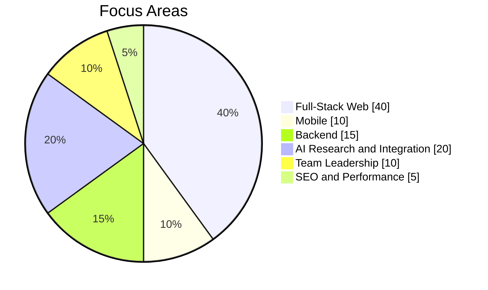
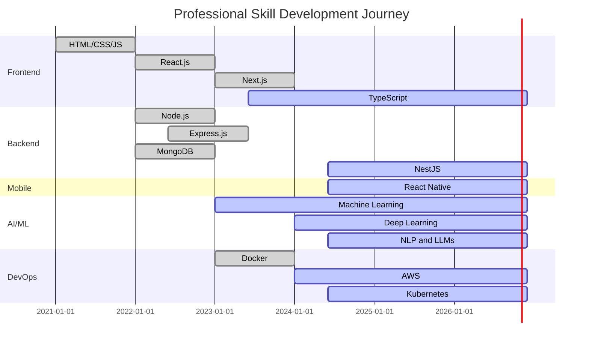

<div align="center">


<br/>


<br/><br/>

[](https://my-personal-portfolio-eight-henna.vercel.app/)
[](https://linkedin.com/in/md-gafrujama-ansari-a8b401287/)
[](https://github.com/md-Gafrujama)
[](mailto:mdgafrujama@gmail.com)

<a href="https://github.com/md-Gafrujama?tab=followers"></a>
<a href="https://github.com/md-Gafrujama?tab=stars"></a>


</div>

---

## 🚀 About Me

<div align="center">
  
  <h3>💡 Transforming Ideas Into Digital Reality</h3>
  <p><em>Full Stack Engineer · Tech Lead · AI Enthusiast · Open Source Contributor</em></p>
</div>

<div align="center">

| 🎯 Aspect | 📝 Details |
|:---------:|:----------|
| **🔭 Current Role** | Full Stack Engineer & Tech Lead at **QUORE B2B Marketing** |
| **🧠 Focus** | AI Research & Integration, LLM-powered apps, scalable architecture |
| **🌱 Learning** | Advanced AI Integration, Microservices, Cloud Architecture, Web3 |
| **👯 Collaborating On** | AI-powered applications & Open Source projects |
| **💬 Core Expertise** | MERN, Next.js, React Native, NestJS, AI/ML, SEO, Team Leadership |
| **⚡ Superpower** | Building full-stack apps while optimizing for SEO and performance |
| **🏆 Experience** | 2+ years of professional development |

</div>

### 🌈 Fun Facts

- 🎮 Love building games and interactive experiences in free time
- 🎵 Code best with Lo-fi and synthwave
- 🌙 Night owl developer, best code happens after midnight
- ☕ Coffee-driven development
- 🤝 Mentor developers across different technologies
- 🌟 Believe in *"Code with purpose, build with passion"*

---

## 🛠️ Tech Arsenal

<div align="center">
  
</div>

### 🎯 Core Stack

<div align="center">
  
</div>

### 🎨 Frontend & Mobile
<div align="center">


</div>

### ⚙️ Backend, Databases & Cloud
<div align="center">


</div>

### 🤖 AI / ML
<div align="center">


</div>

### 🎯 Digital Marketing & SEO
<div align="center">


</div>

### 🛠️ Dev Tools
<div align="center">


</div>

---

## 🧊 3D Contribution Graph

<div align="center">
  <!-- Generated daily by .github/workflows/profile-3d.yml -->
  
</div>

---

## 📊 Skills & Analytics

<div align="center">
  
</div>

### 📈 Proficiency Radar

<div align="center">
  
</div>

### 🥧 Where My Time Goes



### 💻 Skill Breakdown

<table>
<tr>
<td width="50%">

**🎨 Frontend**
```text
HTML5/CSS3     ██████████ 98%
React.js       ██████████ 96%
JavaScript     ██████████ 95%
Next.js        █████████░ 94%
Tailwind CSS   █████████░ 92%
TypeScript     █████████░ 88%
Vue.js         ████████░░ 85%
Angular        ███████░░░ 75%
```

</td>
<td width="50%">

**⚙️ Backend**
```text
REST APIs      ██████████ 96%
Node.js        █████████░ 92%
Express.js     █████████░ 90%
MongoDB        █████████░ 88%
Python         ████████░░ 85%
Microservices  ████████░░ 82%
GraphQL        ████████░░ 80%
PostgreSQL     ███████░░░ 78%
```

</td>
</tr>
<tr>
<td width="50%">

**🤖 AI / ML**
```text
NumPy          █████████░ 90%
Pandas         █████████░ 88%
Data Viz       ████████░░ 85%
TensorFlow     ████████░░ 82%
NLP            ████████░░ 80%
PyTorch        ███████░░░ 75%
Computer Vis.  ███████░░░ 70%
```

</td>
<td width="50%">

**🎯 SEO & Marketing**
```text
SEO            ██████████ 98%
Analytics      ██████████ 96%
Google Ads     █████████░ 92%
Social Media   █████████░ 90%
Content Mktg   ████████░░ 88%
CRO            █████████░ 88%
Email Mktg     ████████░░ 85%
A/B Testing    ████████░░ 82%
```

</td>
</tr>
<tr>
<td width="50%">

**☁️ DevOps & Cloud**
```text
Docker         █████████░ 90%
Linux          ████████░░ 88%
AWS            ████████░░ 85%
CI/CD          ████████░░ 85%
Security       ████████░░ 83%
Monitoring     ████████░░ 80%
Kubernetes     ███████░░░ 75%
IaC            ███████░░░ 72%
```

</td>
<td width="50%">

**👥 Leadership**
```text
Team Leadership   ██████████ 95%
Problem Solving   ██████████ 95%
Mentoring         █████████░ 92%
Project Mgmt      █████████░ 90%
Collaboration     █████████░ 90%
Agile / Scrum     █████████░ 88%
Stakeholders      ████████░░ 87%
Strategy          ████████░░ 85%
```

</td>
</tr>
</table>

### 🗓️ Skill Development Timeline



---

## 💼 Professional Journey

<div align="center">
  
</div>

<details open>
<summary><b>🚀 Full Stack Engineer & Tech Lead — QUORE B2B Marketing (2024 – Present)</b></summary>

- 🏗️ Lead a development team of **8+ members** building scalable CRM applications
- 🤖 Architected **AI-generated blog systems** using Gemini AI for automated content creation
- 🎨 Built responsive UI with **Next.js, React and Tailwind CSS**
- 📊 Built RESTful APIs with **Node.js, Express and MongoDB**
- 🔧 Designed **microservices-style architecture** for scalability
- 📈 Achieved **~65% average performance improvement**; page load from **4.2s to 1.5s**
- 🗄️ Optimized MongoDB queries, improving response time by **~70%**
- 🚀 Established **CI/CD pipeline**, reducing deployment time by **~80%**
- 👥 Mentored junior developers and delivered 15+ major features ahead of schedule

</details>

<details>
<summary><b>💻 Senior Full-Stack Developer — Ace Credential's (Feb 2024 – Aug 2024, Hybrid)</b></summary>

- 🌐 Delivered **12+ responsive interfaces** for diverse client projects
- ⚡ Built dynamic apps with React and Next.js using modern UI/UX principles
- 🔄 Improved development workflow, reducing development time by ~30%
- 🛠️ **Stack:** React, Next.js, TypeScript, Tailwind, Node.js, Express, MongoDB, Docker, AWS, Figma

</details>

<details>
<summary><b>🎯 Frontend Developer — Cyberlative IT Solutions (Jul 2023 – Dec 2023, Remote)</b></summary>

- 🤝 Collaborated with a cross-functional remote team to build visually appealing websites
- 🏢 Developed the company portfolio showcasing technical capabilities
- 🌐 Built responsive designs for all major browsers and devices
- 🚀 Optimized applications for speed and scalability

</details>

---

## 🏆 Showcase Projects

<div align="center">
  
  <p><em>Building solutions that make a real impact</em></p>
</div>

<table>
<tr>
<td width="50%" valign="top">

### 🤖 AI-Powered Job Portal
**🛠️ Stack:** MERN, Next.js, Tailwind CSS, Gemini AI, Socket.io
- 🔍 AI-powered job matching
- 💬 Real-time chat with WebSockets
- 📍 Geolocation-based job search
- 📧 Automated email notifications
- 🔐 Role-based authentication
- 📱 PWA capabilities
- 📊 Recruiter analytics dashboard

[](#)
[](#)

</td>
<td width="50%" valign="top">

### 📊 CRM & Analytics Dashboard
**🛠️ Stack:** React, Node.js, MongoDB, Chart.js, D3.js
- 📈 Real-time analytics and reporting
- 🔄 Customer lifecycle management
- 🤖 ML-powered lead scoring
- 📧 Email marketing automation
- 🏢 Multi-tenant architecture
- 🔔 Smart notifications
- 📱 Mobile-first design

[](#)
[](#)

</td>
</tr>
<tr>
<td width="50%" valign="top">

### 🛒 Next-Gen E-commerce Platform
**🛠️ Stack:** Next.js 14, TypeScript, Stripe, PostgreSQL, PWA
- ⚡ SSR for SEO
- 💳 Secure multi-option payments
- 📦 Real-time inventory management
- 🎯 AI product recommendations
- 📊 Google Analytics 4 integration
- 🌐 Multi-language and multi-currency

[](#)
[](#)

</td>
<td width="50%" valign="top">

### 🎨 AI Content Generation Studio
**🛠️ Stack:** MERN, OpenAI, AWS S3, Stripe, TailwindCSS
- 🤖 AI content for blogs, ads, social media
- 🌍 Multi-language generation
- 🔍 Built-in SEO keyword analysis
- 🖼️ AI image generation and editing
- 💰 Tiered subscriptions with usage tracking
- 🔄 Template library

[](#)
[](#)

</td>
</tr>
<tr>
<td width="50%" valign="top">

### 🏥 Healthcare Management System
**🛠️ Stack:** React, Node.js, MongoDB, Socket.io, JWT
- 👨‍⚕️ Patient management
- 📅 Appointment scheduling
- 💊 Digital prescriptions
- 📱 Telemedicine video calling
- 🔒 Secure data handling
- 🔔 Automated reminders

[](#)
[](#)

</td>
<td width="50%" valign="top">

### 🎓 EdTech Learning Platform
**🛠️ Stack:** MERN, WebRTC, AWS S3, Razorpay, Socket.io
- 📚 Course creation and management
- 🎥 HD video streaming
- 💬 Real-time discussions
- 📝 Quizzes and assignments
- 📊 Progress analytics
- 🏆 Badges and leaderboards
- 💳 Integrated payments

[](#)
[](#)

</td>
</tr>
</table>

### 🔮 Upcoming

<div align="center">

| 🔮 Project | 🛠️ Technology | 🎯 Goal |
|:----------:|:------------:|:--------:|
| **Blockchain DApp** | Web3, Ethereum, React | Decentralized Finance |
| **IoT Dashboard** | React, Node.js, MQTT | Smart Home Management |
| **ML Prediction Engine** | Python, TensorFlow, FastAPI | Business Intelligence |
| **Mobile Super App** | React Native, NestJS | Cross-platform product |

</div>

---

## 📊 GitHub Analytics

<div align="center">
  
  <br/><br/>

  
  

  <br/>

  

  <br/>

  
  
  

  <br/>

  
  

  <br/><br/>

  
</div>

---

## 🎓 Education

<div align="center">
  
</div>

### 🎓 B.Tech, Electronics & Communication Engineering
**📍 Bihani Deemed University** · 2021 – 2025 · **CGPA 9.7 / 10**

**📚 Core Coursework:** Data Structures & Algorithms · DBMS · Software Engineering · Computer Networks & Security · AI & ML · OOP · Web Technologies · Digital Signal Processing

---

## 🌐 Web Development Resources Hub

<div align="center">
  
  <p><em>Handpicked resources for modern web development</em></p>
</div>

<details open>
<summary><b>🗺️ Learning Roadmaps & Guides</b></summary>

- **[Developer Roadmaps](https://roadmap.sh/)** - Complete learning paths for different technologies
- **[Frontend Roadmap](https://roadmap.sh/frontend)** - Comprehensive frontend development guide
- **[Backend Roadmap](https://roadmap.sh/backend)** - Server-side development roadmap
- **[Full Stack Roadmap](https://roadmap.sh/full-stack)** - End-to-end development path
- **[DevOps Roadmap](https://roadmap.sh/devops)** - Infrastructure and deployment guide
- **[React Roadmap](https://roadmap.sh/react)** - React ecosystem deep dive
- **[Node.js Roadmap](https://roadmap.sh/nodejs)** - Backend JavaScript development
- **[Python Roadmap](https://roadmap.sh/python)** - Python programming and applications
- **[AI & Data Scientist Roadmap](https://roadmap.sh/ai-data-scientist)** - AI/ML specialization
- **[React Native Roadmap](https://roadmap.sh/react-native)** - Mobile development path

</details>

<details>
<summary><b>📚 Documentation & Reference</b></summary>

- **[MDN Web Docs](https://developer.mozilla.org/)** - Authoritative web technology documentation
- **[DevDocs](https://devdocs.io/)** - Fast, offline documentation browser
- **[W3Schools](https://www.w3schools.com/)** - Beginner-friendly web technology tutorials
- **[JavaScript.info](https://javascript.info/)** - Comprehensive modern JavaScript tutorial
- **[React Documentation](https://react.dev/)** - Official React documentation
- **[Next.js Documentation](https://nextjs.org/docs)** - Official Next.js docs
- **[React Native Docs](https://reactnative.dev/docs/getting-started)** - Official React Native docs
- **[Node.js Documentation](https://nodejs.org/docs/)** - Complete Node.js reference
- **[Express.js Guide](https://expressjs.com/)** - Web framework for Node.js
- **[NestJS Documentation](https://docs.nestjs.com/)** - Progressive Node.js framework
- **[MongoDB Manual](https://docs.mongodb.com/)** - Database documentation and tutorials
- **[Can I Use](https://caniuse.com/)** - Browser compatibility checker

</details>

<details>
<summary><b>🎨 Design Tools & Resources</b></summary>

- **[Figma](https://figma.com/)** - Collaborative interface design tool
- **[Adobe XD](https://www.adobe.com/products/xd.html)** - UI/UX design platform
- **[Sketch](https://www.sketch.com/)** - Digital design toolkit
- **[InVision](https://www.invisionapp.com/)** - Prototyping and collaboration
- **[Canva](https://canva.com/)** - Graphic design platform
- **[Dribbble](https://dribbble.com/)** - Design inspiration community
- **[Behance](https://www.behance.net/)** - Creative portfolio showcase
- **[Awwwards](https://www.awwwards.com/)** - Web design inspiration

</details>

<details>
<summary><b>🌈 Colors, Fonts & UI Elements</b></summary>

- **[Coolors](https://coolors.co/)** - Color scheme generator
- **[Adobe Color](https://color.adobe.com/)** - Professional color tool
- **[Google Fonts](https://fonts.google.com/)** - Free web font library
- **[Font Squirrel](https://www.fontsquirrel.com/)** - Commercial-use fonts
- **[Unsplash](https://unsplash.com/)** - High-quality stock photos
- **[Pexels](https://pexels.com/)** - Free stock photography
- **[unDraw](https://undraw.co/)** - Open-source illustrations
- **[Tabler Icons](https://tablericons.com/)** - Free SVG icon library

</details>

<details>
<summary><b>⚙️ Development Tools & Utilities</b></summary>

- **[Visual Studio Code](https://code.visualstudio.com/)** - Popular code editor
- **[WebStorm](https://www.jetbrains.com/webstorm/)** - JavaScript IDE
- **[Postman](https://www.postman.com/)** - API development platform
- **[Insomnia](https://insomnia.rest/)** - API testing tool
- **[GitHub](https://github.com/)** - Version control and collaboration
- **[GitLab](https://gitlab.com/)** - DevOps platform
- **[Vercel](https://vercel.com/)** - Deployment platform
- **[Netlify](https://netlify.com/)** - Web hosting and automation

</details>

<details>
<summary><b>🚀 Performance & SEO Tools</b></summary>

- **[Google PageSpeed Insights](https://pagespeed.web.dev/)** - Performance analysis
- **[GTmetrix](https://gtmetrix.com/)** - Website speed testing
- **[Google Analytics](https://analytics.google.com/)** - Web analytics platform
- **[Google Search Console](https://search.google.com/search-console)** - SEO monitoring
- **[SEMrush](https://semrush.com/)** - SEO and marketing toolkit
- **[Ahrefs](https://ahrefs.com/)** - SEO analysis and research
- **[Lighthouse](https://developers.google.com/web/tools/lighthouse)** - Audit tool
- **[WebPageTest](https://www.webpagetest.org/)** - Performance testing

</details>

<details>
<summary><b>🎯 Practice & Learning Platforms</b></summary>

- **[freeCodeCamp](https://freecodecamp.org/)** - Free coding bootcamp
- **[Codecademy](https://codecademy.com/)** - Interactive coding courses
- **[LeetCode](https://leetcode.com/)** - Algorithm practice platform
- **[HackerRank](https://hackerrank.com/)** - Coding challenges
- **[Codewars](https://codewars.com/)** - Programming kata practice
- **[CodeChef](https://www.codechef.com/)** - Competitive programming
- **[Frontend Mentor](https://frontendmentor.io/)** - Frontend challenges
- **[CSS Battle](https://cssbattle.dev/)** - CSS coding challenges
- **[JavaScript30](https://javascript30.com/)** - 30-day vanilla JS challenge

</details>

<details>
<summary><b>🛤️ Technology Learning Paths</b></summary>

<div align="center">

| 🎯 Path | 📚 Resource | ⏱️ Duration | 🎓 Level |
|:-------:|:-----------|:----------:|:--------:|
| **Frontend** | [Frontend Roadmap](https://roadmap.sh/frontend) | 6-8 months | Beginner to Expert |
| **Backend** | [Backend Roadmap](https://roadmap.sh/backend) | 8-10 months | Beginner to Expert |
| **Full-Stack** | [Full-Stack Path](https://roadmap.sh/full-stack) | 12+ months | Comprehensive |
| **DevOps** | [DevOps Roadmap](https://roadmap.sh/devops) | 10-12 months | Intermediate to Expert |
| **AI/ML** | [AI/ML Roadmap](https://roadmap.sh/ai-data-scientist) | 12-18 months | Advanced |
| **Mobile** | [React Native](https://roadmap.sh/react-native) | 6-8 months | Intermediate |

</div>

**Specialized tracks:** 🔐 Cybersecurity · 🌐 Web3 & Blockchain · 📊 Data Science · 🎮 Game Dev · 📱 Mobile-first

</details>

<details>
<summary><b>🔧 Technical References</b></summary>

- **📊 Database Design:** PostgreSQL docs, MongoDB manual, Redis documentation
- **☁️ Cloud Platforms:** AWS documentation, Google Cloud guides, Azure tutorials
- **🔒 Security:** OWASP guidelines, security best practices
- **🚀 Performance:** Web.dev performance guides, Core Web Vitals
- **🧪 Testing:** Jest, Cypress, React Testing Library
- **📱 Mobile:** React Native, Flutter, native platform guides

</details>

---

## 🔧 Git & GitHub Workflow

<div align="center">
  
</div>

<details>
<summary><b>🚀 Getting Started & Configuration</b></summary>

```bash
git config --global user.name "Your Name"
git config --global user.email "your.email@example.com"
git config --list

git init
git clone https://github.com/username/repository.git
git clone https://github.com/username/repository.git my-folder-name
```

</details>

<details>
<summary><b>📝 Basic Workflow</b></summary>

```bash
git status
git add .                    # Add all files
git add filename.js          # Add specific file
git add src/                 # Add entire directory

git commit -m "Your commit message"
git commit -am "Add and commit tracked files"

git log
git log --oneline
git log --graph --oneline
git log --all --graph --decorate

git diff                     # Unstaged changes
git diff --staged            # Staged changes
git diff HEAD                # All changes
```

</details>

<details>
<summary><b>🌿 Branching & Merging</b></summary>

```bash
git branch                    # List branches
git branch branch-name        # Create branch
git branch -d branch-name     # Delete branch
git branch -D branch-name     # Force delete

git checkout branch-name
git checkout -b new-branch
git switch branch-name
git switch -c new-branch

git merge branch-name
git merge --no-ff branch-name

git rebase main
git rebase -i HEAD~3
```

</details>

<details>
<summary><b>🔄 Remote Operations</b></summary>

```bash
git remote -v
git remote add origin URL
git remote remove origin
git remote set-url origin URL

git push origin main
git push -u origin main
git push --all
git push --tags

git pull origin main
git fetch origin
git fetch --all
```

</details>

<details>
<summary><b>🔍 Advanced Commands</b></summary>

```bash
# Undo changes
git restore filename.js
git restore --staged file.js
git reset HEAD~1             # Undo last commit (keep changes)
git reset --hard HEAD~1      # Undo last commit (discard changes)
git revert HEAD              # New commit that undoes changes

# Stash
git stash
git stash save "message"
git stash list
git stash pop
git stash apply
git stash drop

# Tags
git tag
git tag v1.0.0
git tag -a v1.0.0 -m "Release"
git push origin v1.0.0

# Clean up
git clean -n                 # Preview
git clean -f
git clean -fd
```

</details>

<details>
<summary><b>🔐 GitHub CLI & Fork Workflow</b></summary>

```bash
gh auth login
gh repo clone user/repo
gh repo create
gh repo view
gh issue list
gh pr create
gh pr list
gh pr checkout 123

# Fork and contribute
git clone https://github.com/YOUR-USERNAME/repo.git
cd repo
git remote add upstream https://github.com/ORIGINAL-USER/repo.git
git checkout -b feature-name
git add .
git commit -m "Add new feature"
git push origin feature-name
# Open a Pull Request on GitHub

# Keep fork updated
git fetch upstream
git merge upstream/main
git push origin main
```

</details>

<details>
<summary><b>📋 Commit Convention & Cheat Sheet</b></summary>

```bash
# Format: <type>(<scope>): <subject>
feat:      # New feature
fix:       # Bug fix
docs:      # Documentation
style:     # Formatting only
refactor:  # Code refactoring
test:      # Tests
chore:     # Maintenance

git commit -m "feat(auth): add user login functionality"
git commit -m "fix(api): resolve CORS issue"
git commit -m "docs(readme): update installation guide"
```

<div align="center">

| ⏰ Time | 🔄 Action | 💻 Command |
|:------:|:--------:|:----------:|
| **Morning** | Check status | `git status` |
| **Before work** | Pull latest | `git pull origin main` |
| **During work** | Stage changes | `git add .` |
| **After feature** | Commit | `git commit -m "feat: description"` |
| **Before push** | Check diff | `git diff HEAD` |
| **End of day** | Push changes | `git push origin main` |

</div>

</details>

---

## 🎵 Coding Environment

<div align="center">
  

  <table>
  <tr>
  <td align="center" width="20%">
    <br>
    <sub><b>Deep Focus</b></sub>
  </td>
  <td align="center" width="20%">
    <br>
    <sub><b>High Energy</b></sub>
  </td>
  <td align="center" width="20%">
    <br>
    <sub><b>Late Night Debugging</b></sub>
  </td>
  <td align="center" width="20%">
    <br>
    <sub><b>Algorithm Design</b></sub>
  </td>
  <td align="center" width="20%">
    <br>
    <sub><b>Sprint Coding</b></sub>
  </td>
  </tr>
  </table>

  **🎼 Current mood:** *Synthwave beats while architecting the future* ✨
</div>

---

## 💭 Philosophy

<div align="center">

> *"Code is not just about solving problems. It's about creating solutions that make life better for everyone."*

</div>

- **Clean Code:** write code that tells a story
- **User-Centric:** always prioritize user experience
- **Continuous Learning:** technology never stops evolving, neither should we
- **Team Collaboration:** great software is built by great teams
- **Open Source:** knowledge shared is knowledge multiplied

---

## 🤝 Let's Connect

<div align="center">

  <p>I'm always open to new projects, collaborations, and tech leadership opportunities.</p>

  [](https://my-personal-portfolio-eight-henna.vercel.app/)
  [](https://linkedin.com/in/md-gafrujama-ansari-a8b401287/)
  [](https://github.com/md-Gafrujama)
  [](mailto:mdgafrujama@gmail.com?subject=Collaboration%20Opportunity)

  <br/><br/>

  

  <p><em>Thanks for stopping by! Drop a ⭐ on repos you like.</em></p>

  

</div>
